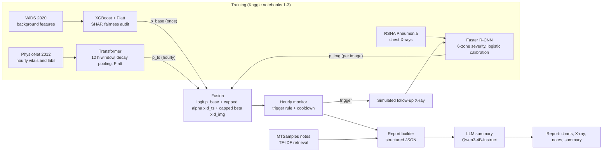
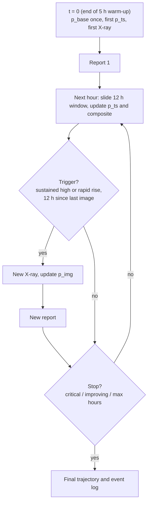

# ICU Risk Monitoring Assistant

A multi-model prototype for **ICU mortality-risk monitoring**. Three independently trained models each look at a different kind of evidence:

- background patient information (XGBoost)
- hourly vitals and labs (Transformer)
- chest X-rays (Faster R-CNN)

Their outputs are combined into a **composite risk index** that is updated every hour. When the vitals model detects sustained or rapid deterioration, the system triggers a (simulated) follow-up X-ray and produces a new report. Each report includes the model evidence, SHAP explanations, a trend chart, the annotated X-ray, retrieved reference notes and an LLM-written summary. The summary is grounded only in the structured model outputs.

> **Research prototype, not a clinical tool.** The datasets come from different patients and are combined into one simulated patient for demonstration. The composite index is a relative risk index, **not** a calibrated probability of death.

---

## Why use this as a prototype

ICU teams continuously combine three kinds of information: who the patient is (age, comorbidities, why they were admitted), how they are trending (vitals and labs), and what imaging shows. Most published models handle one of these at a time and produce a single number with no explanation and no indication of when to look again.

This project shows how such a system could be structured:

- **Baseline + adjustments, as clinicians reason.** A background-only model sets the patient's starting risk once, the way APACHE or SAPS gives an admission estimate. Live vitals and imaging then raise or lower it.
- **Monitoring, not a one-off prediction.** The score is recomputed every hour. A trigger rule tuned on data (with a cooldown) decides when new imaging is warranted, similar to early-warning scores such as NEWS2.
- **Explainable at every step.** SHAP shows the baseline drivers, occlusion analysis shows the vitals drivers, zone grades with bounding boxes show the imaging evidence, and each model's contribution is shown in log-odds.
- **Fairness is checked, not assumed.** The baseline model is audited for equalized odds across ethnicity groups, and equalized-odds post-processing is applied to its binary alert.
- **The LLM explains; it does not decide.** The language model only verbalises a structured JSON. A built-in check flags any number in its summary that was not in its input.

It is a useful template for anyone building multi-source clinical decision-support research. Each component (data, model, fusion rule, LLM) can be swapped without rewriting the rest. It also gives a controlled setting for comparing LLM summarisers (e.g. medical vs. general, aligned vs. unaligned) on the same inputs.

---

## Features

| Component | What it does |
|---|---|
| **Baseline model** (WiDS 2020, XGBoost) | Predicts in-hospital death from **background features only**: age, sex, BMI, comorbidities, admission source and type, diagnosis group. Platt-calibrated, explained with TreeSHAP. |
| **Fairness audit** | Ethnicity is **never a model input**. TPR, FPR, AUROC and calibration are reported per ethnicity, sex and age band. Equalized-odds post-processing (Fairlearn) is applied to the binary flag. A proxy check measures how far ethnicity can be recovered from the remaining features. |
| **Vitals model** (PhysioNet 2012, Transformer) | Estimates risk hour by hour from a 12-hour sliding window of 36 vitals and labs. Uses a 5-hour warm-up, recency-weighted (exponential-decay) pooling and Platt calibration. Occlusion analysis names the driving variables. |
| **Imaging model** (RSNA Pneumonia, Faster R-CNN) | Detects lung opacities with bounding boxes, then converts them into a **Brixia-style 6-zone severity score (0–18)**. The score is mapped to a calibrated probability. |
| **Fusion** | Composite index = baseline log-odds + reliability-weighted, capped adjustments from vitals and imaging. Also reports a model-disagreement score. |
| **Monitoring loop** | Hourly updates, a data-tuned re-imaging trigger (sustained high risk or rapid rise, 12-hour cooldown), simulated follow-up imaging, and stopping rules (critical / improving / time limit). |
| **Grounded reports** | Patient data, SHAP bar chart, trend chart, previous vs. current X-ray, vitals drivers, retrieved MTSamples reference notes, and an LLM summary (Qwen3-4B-Instruct, 4-bit) with a numeric-grounding check. |
| **Sensitivity analysis** | Re-plots the composite trajectory for a grid of α and β values. |

### Results at a glance (held-out test sets)

| Model | Key results |
|---|---|
| Baseline (XGBoost) | AUROC 0.729 · ECE 0.003 · Brier skill score 0.058 · equalized-odds gap 0.124 → 0.066 after post-processing |
| Vitals (Transformer) | AUROC 0.822 (all windows), 0.849 (per patient at 48 h) · Brier skill score **α = 0.20** |
| Imaging (Faster R-CNN) | Image-level AUROC 0.884 · RSNA mAP 0.230 · severity vs. radiologist-box severity Spearman ρ = 0.60 · **β = 0.38** |
| Re-imaging trigger | Fires for 20% of survivors vs. 69% of patients who died (test set) |

---

## Architecture



**Monitoring flow for one simulated patient:**



### Repository layout

```
training/
  notebook1-medical.ipynb   # WiDS -> XGBoost, SHAP, equalized-odds audit
  notebook2-medical.ipynb   # PhysioNet -> Transformer, calibration, alpha, trigger thresholds
  notebook3-medical.ipynb   # RSNA -> Faster R-CNN, severity score, calibration, beta
notebook4-medical.ipynb     # end-to-end demo: fusion, monitoring, reports
utils/                      # fusion, time-series helpers, patient builder, grounding, prompting, LLM, report
metadata.txt                # dataset links, model list, Hugging Face link for trained artifacts
```

Each training notebook saves its model, preprocessing, calibrator, metrics and a small loader module (`xgb_inference.py`, `ts_inference.py`, `img_inference.py`). Notebook 4 loads them as artifacts and never retrains. Trained artifacts are hosted on Hugging Face; the link is in `metadata.txt`.

---

## Design decisions

**1. Independent evidence channels.** No free dataset contains background data, hourly vitals and chest X-rays for the same patients. Each model is therefore trained on its own dataset. At demo time, one record from each test set is combined into a single simulated patient, matched on age and sex where possible. The same approach was used in the [SOC Analyst Assistant](https://github.com/AnarvaKamdar1/SOC-Analyst-Assistant), which combines independent malware detectors.

**2. Baseline plus adjustments, not an average.** XGBoost answers "what is the usual risk for someone with this background?" and runs once. Vitals and imaging answer "what is happening to this patient now?" and adjust that baseline up or down. An average would let a reassuring vitals window erase a high-risk background, or the reverse. Additive adjustments in log-odds keep each source's role clear.

**3. No vital signs in the baseline.** WiDS contains first-24-hour vitals and APACHE scores, and those were excluded from the baseline model. Otherwise the same physiology would be counted twice: once in the baseline and again in the vitals adjustment.

**4. Ethnicity used for auditing only.** Ethnicity is excluded from the probability model and used only to audit fairness and to post-process the binary flag. The probability itself is left unconstrained.

**5. Conflicts replaced by a disagreement score.** Because the channels come from different people, any "conflict" between them would be an artefact of the simulation. The system reports how far apart the vitals and imaging contributions are, and whether they point in opposite directions, without trying to resolve it.

**6. The LLM summarises only.** All numbers and decisions come from the models and the trigger rule. The LLM receives a structured JSON summary and is told to use only those facts, to call the composite an index rather than a probability, and to treat retrieved notes as context from other patients.

**7. A general instruction-tuned model for summaries.** MedGemma 1.5 4B was tried first. It is a "thinking" model, and its reasoning often used up the token budget or looped before an answer appeared. When it did answer, it misread fields. Since the task is to verbalise structured data rather than supply medical knowledge, Qwen3-4B-Instruct (non-thinking, ungated) is the default. MedGemma remains supported for comparison.

---

## Methods

### Calibration (why and how)

Every model is calibrated before fusion. The composite combines **probabilities from three different models trained on different datasets**. Raw model scores are not comparable:
- XGBoost, Transformers and detectors produce confidences on different scales.
- Class weighting or early stopping can make a model overconfident or underconfident.

- **Platt scaling** (a logistic regression on the raw logit, fitted on the validation split) is used for XGBoost and the Transformer. The vitals model was slightly overconfident (slope 0.78), and Platt scaling brought its expected calibration error (ECE) from 0.029 down to 0.008.
- **The imaging model** has no single probability output, so a logistic regression maps `[logit(max box score), severity total]` to "opacity present". This gives a calibrated `p_img` that still rises with severity.
- **No class re-weighting** was used in any loss function. Re-weighting improves recall but pushes probabilities away from the true event rate, which would distort the fusion.

### Why log-odds

Fusion happens on the log-odds (logit) scale:

```
Δ_ts  = logit(p_ts)  − logit(base rate of the vitals training set)
Δ_img = logit(p_img) − logit(base rate of the imaging training set)

z          = logit(p_base) + clip(α · Δ_ts, ±2) + clip(β · Δ_img, ±2)
composite  = sigmoid(z)
```

- **Additive evidence.** In log-odds, independent pieces of evidence add, as in logistic regression or Bayesian updating with likelihood ratios. Multiplying probabilities or averaging them has no such interpretation.
- **Centring makes the adjustments two-sided.** Each Δ is measured against that model's own training base rate. An average-looking vitals window or X-ray contributes about 0; worse than average pushes risk up, better than average pulls it down. This also removes the effect of the datasets having different event rates (14% deaths in PhysioNet vs. 23% opacity in RSNA).
- **Always a valid probability.** Any z maps back into (0, 1), so the index cannot exceed 1 or go negative.
- **The ±2 cap** (about a 7× change in odds) stops one extreme window or image from dominating the baseline. A similar bounded-effect idea was used for the CNN in the SOC project.

### Choosing α and β

α and β are fixed reliability weights, each set to that model's **Brier skill score on its held-out test set**:

```
BSS = 1 − Brier(model) / Brier(always predicting the training base rate)
α = clip(BSS_vitals, 0, 1) = 0.20      β = clip(BSS_imaging, 0, 1) = 0.38
```

- **Brier score rather than F1.** F1 depends on the decision threshold and on how common the event is, and it ignores whether the probabilities are trustworthy. The Brier score measures probability quality directly, which matters because probabilities are what get fused.
- **Skill score rather than raw Brier.** Raw Brier looks better simply when the event is rare. The skill score compares each model with a no-information baseline, so models trained on different datasets become comparable. A model with no skill gets weight 0 and contributes nothing.
- **Known caveat.** β > α because detecting an opacity is an easier task than predicting death. These weights measure each model's skill **on its own task**, not how much its evidence should move mortality risk. True weights cannot be learned without data that has all modalities for the same patients. The notebook therefore includes an α/β sensitivity plot to show how much the trajectory depends on these choices.

### Baseline model and fairness

- XGBoost uses 20 background features and early stopping, and is explained with TreeSHAP (one-hot columns are summed back to the original feature).
- **Equalized odds** (equal true- and false-positive rates across groups) was chosen as the fairness criterion, because it matters most for alerts. Fairlearn's `ThresholdOptimizer` is applied to the **binary flag only**. Post-processing typically randomises decisions, which would make a fair probability unusable for fusion, so the calibrated `p_base` is kept unconstrained.
- Result: the ethnicity TPR gap fell from 0.124 to 0.066 and the FPR gap from 0.124 to 0.030, with balanced accuracy going from 0.663 to 0.646. The group calibration plot shows the original gap came from real differences in base rates, not miscalibration. This is the textbook case where equalized odds and per-group calibration cannot both hold.
- **Proxy check.** Ethnicity can be predicted from the remaining features with AUROC 0.725, mainly through ICU type, admission source and diagnosis group. Removing the attribute is not enough on its own, which is why the outcomes are audited explicitly.

### Vitals model and recency weighting

- **Input.** For each of 36 variables per hour: the last observed value (z-scored, carried forward), whether it was measured that hour, and the time since it was last measured. This encodes missingness, which in ICU data carries clinical information.
- **Architecture.** A 2-layer Transformer encoder, following the SOC project's API-sequence Transformer. Positional encodings count back in hours from the prediction time, so the latest hour always has the same position whether the window is in warm-up (5–11 h) or full (12 h).
- **Recency weighting.** Pooling over hours uses exponential-decay weights. The half-life was chosen on validation from {3, 6, 12} h and came out at 12 h. All three were nearly tied, which suggests attention already focuses on the relevant hours.
- **Label and split.** Every window carries the patient's in-hospital outcome. Data are split **by patient**, so windows from one person never appear in both training and test.

### Re-imaging trigger

```
trigger if   p_ts ≥ θ for 3 consecutive hours
        or   p_ts rises by ≥ δ within 4 hours and ends above the training base rate
and          at least 12 hours have passed since the previous image (the t = 0 image counts)
```

θ and δ are percentiles of **validation survivors'** values. The pair was picked by a grid search that maximises the share of deaths triggered while triggering for at most 20% of survivors. Tuning at the patient level matters: an earlier per-window threshold fired for 42% of survivors, because a 95th-percentile rise is crossed by chance when it is checked about 40 times per stay.

### Imaging severity

- Faster R-CNN (ResNet-50 FPN, COCO-pretrained) is fine-tuned on balanced epochs: every positive image plus an equal number of re-drawn negatives each epoch.
- The box threshold is chosen on validation to maximise the RSNA competition metric.
- **Brixia-style score.** The lung field is split into 6 zones (right/left × upper/middle/lower). Each zone is graded 0–3 by box coverage (≥ 5%, ≥ 25%, ≥ 50%), giving a total from 0 to 18. RSNA has no severity labels, so the score is validated against the same score computed from the radiologists' boxes (Spearman ρ = 0.60). It also separates the three RSNA classes: mean predicted severity 0.0 for Normal, 1.2 for not-normal-no-opacity, and 5.3 for Lung Opacity.

### Grounding and summarisation

- **Retrieval.** MTSamples notes are indexed with TF-IDF, with duplicate transcriptions removed. The query is built from the diagnosis group, imaging findings and the top vitals drivers, which mirrors the reference lookup in the SOC project.
- **Summary.** The LLM receives a structured JSON (model outputs, contributions, changes since the last report, notes, caveats) and returns six fixed sections. Qwen3-4B-Instruct is loaded in 4-bit. If the LLM fails, a deterministic template summary is used instead.
- **Numeric grounding check.** Every number in the summary is matched against the input JSON, allowing for rounding and percentage forms. Any unmatched number is flagged in the report.

### Simulating longer stays

PhysioNet provides 48 hours per patient. To demonstrate monitoring over 120–150 hours, further records from the same outcome group are appended. Each next record is the one whose first 12 hours best match the last 12 hours of the chain. The joins are marked on every chart.

---

## Limitations

- **Simulated patient.** Background, vitals and images come from three different people. Agreement or disagreement between models is not clinically meaningful, and follow-up X-rays are other patients' images chosen to be more or less severe.
- **Composite index is not a probability of death.** The models predict different events (death, death given vitals, opacity), and α and β cannot be validated without data from the same patients.
- **Reliability weights reflect each model's own task.** β exceeds α because opacity detection is easier, not because imaging is more informative about mortality.
- **The vitals label is the final outcome** for every window ("risk given data so far"), not a true short-term deterioration label. Windows from the same patient are correlated, so window-level metrics overstate the effective sample size.
- **Stays beyond 48 hours are stitched** from other patients' records.
- **Imaging zones are fixed rectangles**, not segmented lungs, and the severity score is validated only against radiologist boxes. Large boxes can saturate several zones.
- **Fairness can only be audited on the baseline**, since PhysioNet and RSNA have no ethnicity field. The equalized-odds flag also needs group membership at decision time.
- **The grounding check catches invented numbers, not misattributed facts.** In one run the summary described a reference note's history as if it belonged to this patient. This kind of error needs a semantic check.
- **Data scope.** WiDS, PhysioNet and RSNA are mostly US cohorts, so transfer to other populations (e.g. Indian ICUs) is untested.

## Improvements

- **Same-patient multimodal data** (MIMIC-IV + MIMIC-CXR + eICU, with credentialed access) to learn α and β, or the full fusion, directly and to validate the composite as a calibrated probability.
- **A real deterioration label** for the vitals model, e.g. a SOFA increase of 2 or more within N hours, instead of the final outcome.
- **Lung segmentation** before zone scoring, plus a model trained on true severity labels (e.g. Brixia-scored COVID datasets).
- **β that decays with image age**, so older X-rays count less.
- **Fairness-aware training** (e.g. reweighting or in-processing constraints), and audits on more attributes once datasets provide them.
- **Semantic grounding checks** for the LLM, e.g. requiring every claim to cite a JSON field, plus a systematic comparison of summarisers (MedGemma vs. general models, before vs. after alignment).
- **Prospective-style evaluation** of the trigger rule: lead time before death, number of images per patient, and false alerts per patient-day.

---

## Datasets

[WiDS Datathon 2020](https://www.kaggle.com/competitions/widsdatathon2020) · [PhysioNet/CinC Challenge 2012](https://physionet.org/content/challenge-2012/1.0.0/) · [RSNA Pneumonia Detection Challenge](https://www.kaggle.com/competitions/rsna-pneumonia-detection-challenge) · [MTSamples](https://www.kaggle.com/datasets/tboyle10/medicaltranscriptions)

Model checkpoints and other artifacts: see the Hugging Face link in `metadata.txt`.
